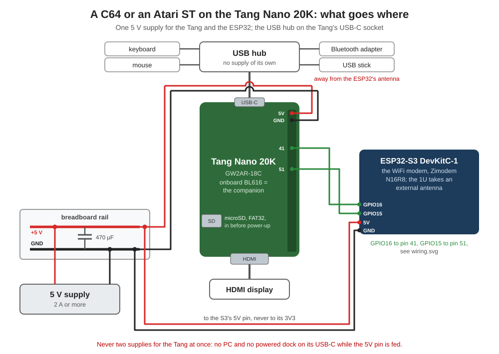
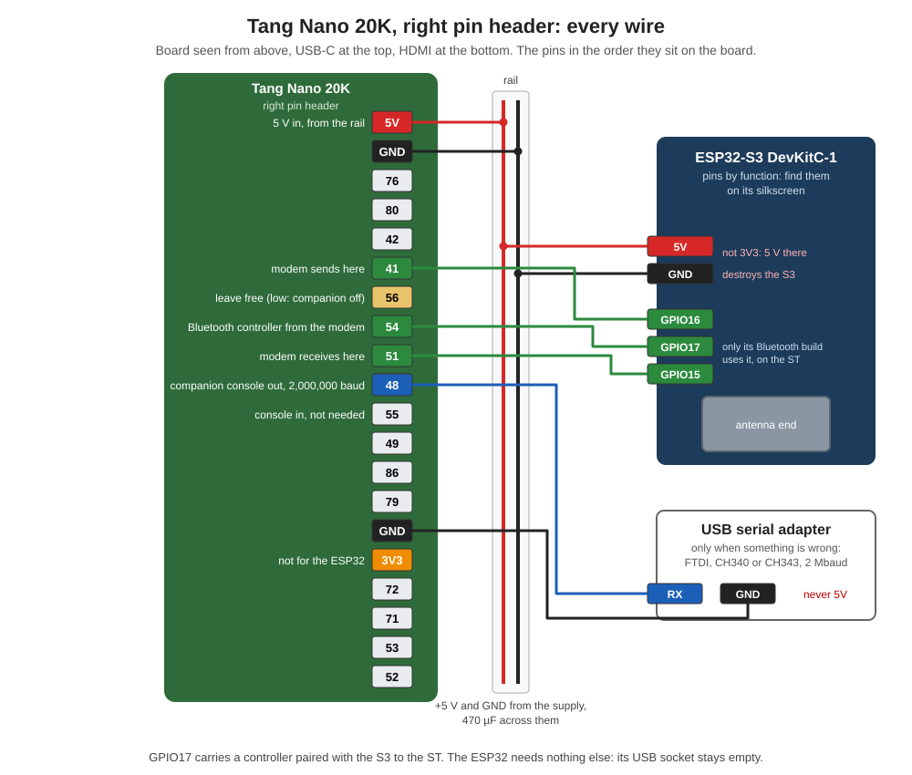

# The hardware

What it takes to rebuild this setup, and how it is wired. Everything here ran
on two boards, revisions 3921 and 3923; the same parts serve the C64 and the
Atari ST, and switching between them only means flashing the other core.

## The parts

### Needed for either machine

| Part | What to look for |
|---|---|
| **Sipeed Tang Nano 20K** | GW2AR-18C with the onboard BL616. Revisions 3921 and 3923 both tested |
| **microSD card** | FAT32, in the Tang before it is switched on. 8 to 32 GB cards are FAT32 out of the box |
| **USB hub** | a plain one without its own supply, with a USB-C plug or a USB-C adapter. A 7 port hub has room for everything below |
| **USB keyboard and mouse** | any; the German layout is the default, see the guides |
| **HDMI display and cable** | any with an HDMI input |
| **5 V supply** | 2 A or more. **Not a PC**: on a PC the BL616 stays a debugger and the companion does not start |
| **Breadboard, jumper wires** | a small breadboard for the 5 V rail, jumper wires from it to the pin headers |
| **Electrolytic capacitor** | 470 µF or more, 10 V or more (16 V is better), **right at the S3's `5V` and `GND` pins** |

### For the network: the WiFi modem

| Part | What to look for |
|---|---|
| **Espressif ESP32-S3 DevKitC-1** | the N16R8 variant (16 MB flash, 8 MB PSRAM): the download is held in its PSRAM. The **DevKitC-1U** is the same board with a socket for an external antenna -- the better choice where the router is far away |
| **Four jumper wires** | 5V, GND and the two signal wires. Bluetooth does not go through the S3: that is the adapter on the hub |

It runs our Zimodem fork, [`esp32/README.md`](esp32/README.md). Without it
both machines run; only the network is missing.

### For Bluetooth keyboards and controllers

| Part | What to look for |
|---|---|
| **USB Bluetooth adapter** | a **Realtek RTL8761B**, often sold as "Bluetooth 5.0 Adapter", USB ID `0bda:8771`. It goes on the hub |

Tested with it: a Logitech K380 (classic Bluetooth), a ROG Azoth X in its
Bluetooth mode (Low Energy) and an Xbox Series controller, all three at
once; the companion takes up to four. Pairing and the reconnect times are in
[`companion/README.md`](companion/README.md).

### For the C64, optional

| Part | What to look for |
|---|---|
| **USB stick** | formatted **FAT32**, no other file system and no images written onto it. On the hub; the C64 reads disk images from it |

### A status display, optional

| Part | What to look for |
|---|---|
| **0.96 inch OLED** | 128x64, **four pins** (GND, VCC, SCL, SDA), controller SSD1306 -- some are SH1106, which works as well. White, blue or yellow-blue makes no difference. It goes on the ESP32-S3 |

It shows the machine, the WiFi with its signal, the address, the clock and
the modem, and while a program comes from the server its progress. Wired as
in the picture below: VCC to the S3's **3V3 pin** -- the one pin where 3.3 V
comes *out*, so this is fine -- GND to GND, SDA to **GPIO8**, SCL to
**GPIO7**. All four sit on the S3's left header, the one a breadboard
leaves reachable. More in [`esp32/README.md`](esp32/README.md).

### When something does not work

| Part | What to look for |
|---|---|
| **USB serial adapter** | 3.3 V logic, able to do **2 Mbaud**: FTDI FT232, CH340 or CH343. It reads the companion's console, which tells what went wrong in plain words |

## The wiring

All wires go to the Tang's **right pin header**, the board seen from above
with USB-C at the top. Counted from the top:

| # | Pin | Wire |
|---|---|---|
| 1 | **5V** | 5 V from the rail |
| 2 | **GND** | GND from the rail |
| 3 | 76 | |
| 4 | 80 | |
| 5 | 42 | |
| 6 | **41** | ESP32-S3 GPIO16: the modem sends here |
| 7 | **56** | **leave free**: pulled low, it switches the companion over to an external dock and the keyboard disappears |
| 8 | 54 | |
| 9 | **51** | ESP32-S3 GPIO15: the modem receives here |
| 10 | **48** | the companion's console out, to the RX of a USB serial adapter, 2,000,000 baud |
| 11 | 55 | console in, not needed |
| 12 | 49 | |
| 13 | 86 | |
| 14 | 79 | |
| 15 | **GND** | GND of the USB serial adapter |
| 16 | 3V3 | **not for the ESP32-S3**, see below |
| 17 | 72 | |
| 18 | 71 | |
| 19 | 53 | |
| 20 | 52 | |

5V and GND are neighbours at the very top: a wire one row off is a short.
`python make_pin_sheet.py` in
[`sources/MiSTeryNano/doc`](sources/MiSTeryNano/doc) prints a label sheet for
both headers.

## Power

- **One 5 V supply for everything.** One pair of wires runs to the Tang's
  5V and GND, one pair to the S3's `5V` and `GND` -- short and not too thin,
  best each pair straight from the supply.
- **The capacitor sits right at the S3**, one leg in the row of its `5V`
  pin, the other in the row of its `GND` pin: long leg to 5V, the side with
  the stripe to GND. It catches the current the radio draws for a few
  milliseconds when it joins and sends, 300 to 500 mA. At the supply it
  would be too far away: the dip would happen in the wire to the S3 all the
  same. It does not make up for wires that lose voltage all the time -- that
  is what the measurement below is for.
- **The ESP32-S3 on 5 V from the rail, never on the Tang's 3V3.** Its radio
  draws 300 to 500 mA when it joins and sends. On the Tang's 3.3 V, which
  also feeds the FPGA, WiFi failed on both boards once the Bluetooth adapter
  and its devices were on the hub. And no supply into the S3's own `3V3`
  pin: 5 V there destroys it. Only the status display takes its 3.3 V *out*
  of that pin. The S3's USB sockets stay empty in use.
- **Measure the rail once, with everything running**: at least **4.8 V**
  between 5V and GND, and **3.3 V** on the S3's `3V3` pin. A supply that
  sags to 4.3 V under load still runs the Tang, but not the S3: its 3V3
  then sat at 2.4 V, its reset pin with it, and the S3 never started. The
  red LED on it lit all the same, and the companion said `No modem on
  port 1` -- it looked like anything but the supply.
- **Exactly one way into the Tang.** Its 5V pin, its USB-C socket and a dock
  that feeds power back through USB-C all reach the same rail. While the 5V
  pin is fed, the USB-C socket carries only the hub -- no PC, no powered
  dock. Two sources at once and the USB host does not come up: a picture,
  but keyboard and mouse are dead.
- **The hub always on the Tang's USB-C socket**: that is where the USB host
  is.

## The antenna

WiFi below about -70 dBm is not reliable: listings need several tries and
downloads stall. The companion's console prints the S3's signal on every
`FETCH` line as `rssi`. Lay the end of the S3 with the antenna clear of the
Tang, the cables and metal, pointing towards the router, keep the Bluetooth
adapter and the USB stick away from it, or take the DevKitC-1U with an
external antenna.

## Flashing

The Tang is flashed on the PC over its USB-C socket, the guides go through
it step by step: [`c64/README.md`](c64/README.md) and
[`atarist/README.md`](atarist/README.md). Two things that cost time:

- **Gowin's programmer or openFPGALoader.** Which one finds the board
  depends on the driver Windows gave it. Windows binds the driver per serial
  number, and boards can share one: the 3921 and the 3923 here both report
  `2025030317` and get the same driver. Both routes are in the guides.
- **Flashing and running are two different places.** On the PC the BL616 is
  a programmer; only on the supply does it start as the companion. To flash
  the companion itself the BL616 goes into its update mode first, with the
  button marked UPDATE, see
  [`companion/README.md`](companion/README.md).

The ESP32-S3 is flashed off the Tang, through its USB socket marked UART:
[`esp32/README.md`](esp32/README.md).

The pictures are drawn by
[`docs/hardware/make_diagrams.py`](docs/hardware/make_diagrams.py); a pin
changes there, not in the SVG files.
